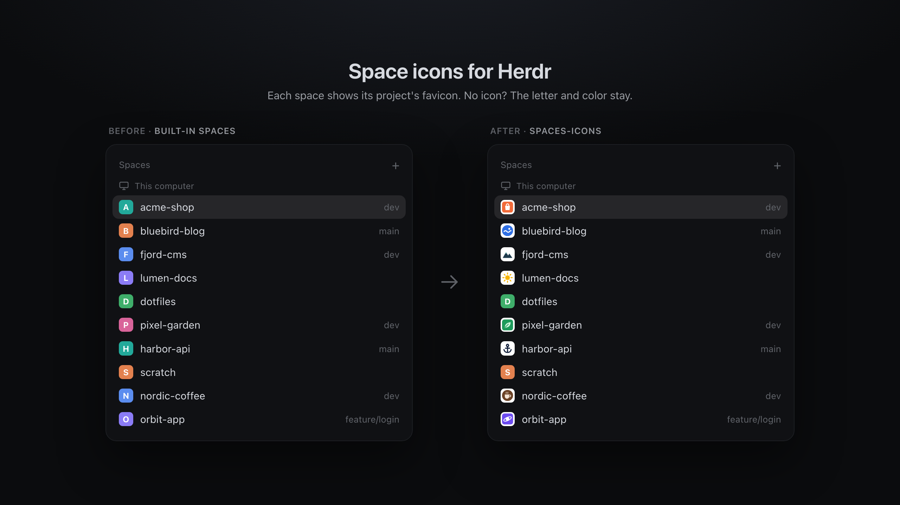

# Space icons for Herdr

A [Herdr](https://herdr.dev) mod that puts each project's own icon in the
Spaces sidebar. It finds the favicon, app icon or logo in the space's folder
and shows it where Herdr draws the colored letter. A space without an icon
keeps its letter and color, as before.



## What it does

- **Finds the icon in your project.** It looks in the git top of the space
  (or its folder) and in the usual web roots and theme folders. See
  [Where it looks](#where-it-looks).
- **Picks the best one.** Square icons made for small sizes win:
  `favicon.svg` / `icon.svg`, then `apple-touch-icon.png`, large
  `favicon-*.png`, `favicon.ico`, and a theme's `logo.svg` / `logo.png`
  last. Wide logos are skipped, because they can't be read at 18 px.
- **Keeps it readable.** Each icon is drawn on a small white tile, the way a
  browser tab shows it, so dark favicons stay visible in dark themes.
- **Falls back to the letter.** No icon, the home folder, or an icon that
  can't be read: the space keeps Herdr's letter and color.
- **Stays current.** It looks again when a space moves to another folder,
  and every 10 minutes.
- **Lets you choose.** Right-click a space and pick **Change icon…** to choose
  one of the icons found in the project, any image file, or the letter.
- **Works on other machines.** For a space on another machine (`hc machine`),
  the icon is read there and copied to this computer.

Everything else is Herdr's own Spaces sidebar, unchanged: worktrees nested
under their repo, branch, ahead/behind, machines and drag to reorder. The
right-click menu has Herdr's items (Rename, New/Open/Remove worktree, Close)
plus **Change icon…**.

## Install

Ask the agent you run in Herdr:

```text
Read ~/.config/herdr-app/AGENTS.md, then add this mod: https://github.com/sockiplastsmurfen/herdr-space-icons
```

Or do it by hand:

1. Copy `mods/spaces-icons/` to `~/.config/herdr-app/mods/spaces-icons/`.
2. Point your layout's Spaces block at it. Herdr's own layouts are read-only,
   so make a copy first:

   ```sh
   herdr-app do layout.clone '{"name":"main","as":"my-main"}'
   ```

   In `~/.config/herdr-app/layouts/my-main.json`, find the block with
   `"id": "spaces"` and change its `"mod": "spaces"` to `"mod": "spaces-icons"`.
3. Check it:

   ```sh
   herdr-app check ~/.config/herdr-app/mods/spaces-icons
   ```

To go back, change the layout's mod back to `"spaces"` or switch layouts with
`ctrl-shift-l`.

## Choose an icon yourself

Right-click a space and pick **Change icon…**. The dialog shows:

- **The icons found in the project**, as thumbnails (up to 12, wide logos
  included). Click one to use it.
- **Automatic**: go back to the icon it finds by itself.
- **Letter**: keep Herdr's letter and color.
- **Choose file…**: any image, in the macOS file dialog. Only for spaces on
  this computer.
- **Background** (with an icon): the tile behind it. Choose no tile, white
  (the default), dark, or one of Herdr's six avatar colors.
- **Letter color** (with the letter): one of Herdr's six avatar colors. It is
  saved in Herdr's own `space.colors`, so the space picker shows it too.

Colors apply at once, so you can try them with the dialog open.

The choice is kept per space (Herdr's shared state `spaces-icons.choice`), so
it survives renaming the space.

You can also set icons by hand in
`~/.config/herdr-app/mods/spaces-icons/icons.json`, with space names as keys.
A choice made in the dialog wins over this file:

```json
{
  "my-shop": "web/themes/custom/shop/logo.svg",
  "dotfiles": false
}
```

A path is relative to the project (or absolute). `false` keeps the letter.
Saving the file reloads the mod.

## Where it looks

Only in these folders, not throughout the project:

| Kind | Folders |
| --- | --- |
| Any project | `.`, `public`, `static`, `assets`, `assets/icons`, `assets/images`, `assets/img`, `images`, `img`, `html`, `src/assets`, `src/public`, `resources/public` |
| Drupal | `web`, `docroot`, `wwwroot`, and `themes/custom/*` under them (with `favicon/` and `images/`) |
| WordPress | `wp-content/themes/*` (with `assets/images/` and `images/`), Bedrock's `web/app/themes/*` |
| Next.js | `app`, `src/app` (`icon.svg`, `favicon.ico`, `apple-icon.png`) |
| Laravel, Symfony, Rails, Vite | `public` |

It never searches the home folder itself. A non-git folder is searched in the
same places.

**WordPress note:** many sites set their icon as a *Site Icon* in wp-admin.
That image lives in `wp-content/uploads/` under a generated name and is
referenced from the database, so no file search finds it. Point to it in
`icons.json`.

## What it runs and writes

Herdr mods are trusted code, so here is everything this one does beyond
Herdr's own sidebar:

- **Runs** `sh` with a fixed script that calls `git rev-parse`, `stat` and a
  folder listing, plus `test`, `mkdir`, `cp`, `mv` and `rm`. It also uses
  `base64` for spaces on other machines and `sips` (macOS) to convert `.ico`
  files and read image sizes, and `osascript` for the file dialog (macOS).
- **Reads** files only in the folders listed above, and its own `icons.json`.
- **Writes** copies of the icons to `~/.config/herdr-app/data/spaces-icons/`,
  because Herdr draws images only from its own folder.
- **Keeps** choices from the icon dialog as `spaces-icons.choice` (space id to
  a file path, or `false` for the letter) and `spaces-icons.tile` (space id to
  a tile color). A letter color goes to Herdr's `space.colors`.
- **Shares** the result as `space.icons` (space id to image path) in Herdr's
  shared state, so other mods can draw the same icons.
- **No network access.**

## Requirements and limits

- Herdr desktop app, macOS or Linux.
- `.ico` files need `sips`, so they are converted on macOS only. On Linux,
  `.ico` files are skipped and the next candidate is used.
- **Choose file…** uses the macOS file dialog. Elsewhere, and for spaces on
  other machines, pick from the found icons or use `icons.json`.
- Icons over 512 KB are skipped.
- The space picker (`picker`) still shows letters. It can read `space.icons`
  if you clone it too.
- This is a copy of Herdr's `spaces` mod (0.1.16) with icons added. Herdr's
  updates to that mod won't reach it; `RECIPE.md` describes how to build it
  again on a newer version.

## License

Apache License 2.0. Based on the `spaces` mod from
[Herdr](https://github.com/herdrdev/herdr-app), also Apache-2.0; see
[NOTICE](NOTICE).
