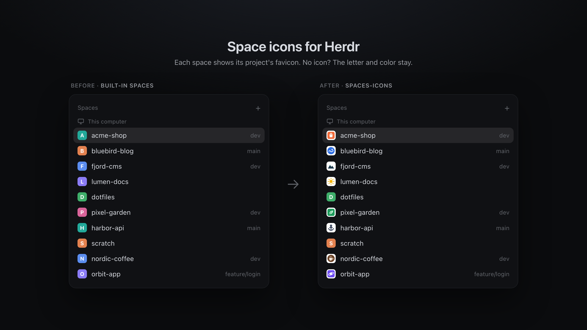

# Space icons

Herdr's Spaces sidebar with each project's own icon in place of the colored letter. The mod finds a favicon, app icon or logo in the space's project and draws it on a small white tile at the start of the row. A space without a usable icon keeps Herdr's letter and color.

This file is the brief: enough to build Space icons from an empty folder. The files next to it are one build of it. If they don't work on your Herdr, or you want it different, build it again from here.

## What you see

- The usual Spaces sidebar: a "Spaces" header with `+`, machine groups ("This computer", other machines), one 30px row per space and 28px rows for worktrees under their repo.
- At the start of each top-level space row, an 18×18px avatar with 5px rounded corners:
  - **With an icon:** a white (`#ffffff`) tile with the project's icon centered at 14×14px, in full color, clipped to the rounded corners.
  - **Without one:** Herdr's own avatar, unchanged. The first letter of the space's name, uppercase, bold, 10.5px, white on the space's color from shared `space.colors` (`ansi6 #22a99a`, `ansi3 #e3814f`, `ansi4 #5b8def`, `ansi5 #8b7cf6`, `ansi2 #3fae6a`, `ansi1 #d9649a`).
- Worktree rows keep the branch glyph and get no avatar. The narrow rail (sidebar under 160px) keeps numbers and status dots, without icons.
- The space name, then the git tail (branch, ↑ahead, ↓behind) where unusual, exactly as in Herdr's `spaces`.

## How it behaves

- Agent statuses (working, blocked, done, idle) show as in Herdr's `spaces`: rows don't change color, and the rail shows `●` for blocked or done and `·` otherwise, in the theme's status color. Icons don't react to status.
- Click selects a space, right-click opens the space menu, and dragging reorders, all unchanged.
- **Finding an icon.** The project is the git top of the space's first terminal's folder, or the space's folder when there is no repo. The home folder and `/` are never searched. Only these folders are listed (no deep search): `.`, `web`, `public`, `wwwroot`, `docroot`, `html`, `static`, `assets`, `assets/icons`, `assets/images`, `assets/img`, `images`, `img`, `src/assets`, `src/public`, `app`, `app/public`, `src/app`, `resources/public`, `{web,wwwroot,docroot}/themes/custom/*`, `web/themes/custom/*/{favicon,images}`, `wwwroot/themes/custom/*/favicon`, `wp-content/themes/*` (with `assets/images`, `images`), `web/app/themes/*` (with `assets/images`), `public/wp-content/themes/*`.
- **Candidates and ranking.** Names: `favicon*.svg`, `favicon*.png`, `favicon.ico`, `icon.svg`, `icon.png`, `apple-touch-icon*.png`, `apple-icon*.png`, `android-chrome-*.png`, `logo.svg`, `logo.png`. Non-empty files of 512 KB or less. Scores:

  | Score | Files |
  | --- | --- |
  | 100 | `favicon.svg`, `icon.svg` |
  | 90 | `apple-touch-icon*`, `apple-icon*` |
  | 88 | `android-chrome-*` |
  | 86 | other `favicon*.svg` |
  | 85 | `favicon-96/128/192/256*` |
  | 82 | `icon.png` |
  | 80 | `favicon-32*` |
  | 78 | `favicon.png` |
  | 70 | `favicon.ico` |
  | 60 | other `favicon*` |
  | 40 | `logo.svg` |
  | 35 | `logo.png` |

  Then −5 inside a `/themes/` path, and −0.1 per path segment. The best 4 are tried in order. One is kept only when its width/height is 0.67–1.5: the SVG `viewBox` or `width`/`height`, or `sips` pixel size for raster images. An unknown size counts as square.
- **Overrides.** `mods/spaces-icons/icons.json` maps a space name to a path (relative to the project, or absolute), or to `false` for the letter. It is read at most every 5 seconds. Saving it reloads the mod.
- **Updates.** The mod looks for an icon when a space first appears, when its name or folder changes, and 10 minutes after the last look. The checks ride the sidebar's 250ms tick, one batch at a time. If a machine is away, the space keeps the icon it had.
- Nothing animates. The row redraws only when an icon changes.

## Built from

- **One mod**, `mods/spaces-icons/`: `main.js`, `icons.js` and `mod.json` (`{ "place": "none", "title": "Spaces (project icons)" }`). It is a `mod.clone` of Herdr's shipped `spaces` (0.1.16). The person's layout must use it in place of `spaces`: in a personal layout (`layout.clone` of `main`), set the `"id": "spaces"` block's `content.mod` to `"spaces-icons"`. No `keys.json`.
- **`main.js` changes to the clone:**
  - imports `image` from `gpui-kit`, `checking` from `herdr`, and `findIcon`/`RESCAN` from `./icons.js`;
  - `this.icons` (space id → path or null) and `this.iconLook` (space id → `{key, at}`);
  - `checkIcons(now, spaces, panes, cx)` is called from `checkNew`, and the key is `[name, where(space)]`;
  - work runs in `cx.spawn`, guarded by `iconsBusy` and `checking()`;
  - on change it writes shared `space.icons` (`{spaceId: "data/spaces-icons/<hash>.<ext>"}`) and calls `cx.notify()`;
  - in `row()`, `h_flex().size(18).rounded(5).overflow_hidden().bg("#ffffff").items_center().justify_center().child(image(path).size(14))` when there is an icon, else the original letter avatar.
- **`icons.js`:** `findIcon(name, folder, machine)` runs one `sh -c` script through `exec(..., { on: machine })`. The script resolves the root (`git rev-parse --show-toplevel`), lists the folders above and prints `mtime size path` per candidate (`stat -c` on Linux, `stat -f` on macOS).
  - The chosen file is copied into the app home as `data/spaces-icons/<fnv1a(machine|path|mtime size)>.<ext>`, because `image()` only takes paths inside `~/.config/herdr-app`. Keep it outside `mods/` so writing it doesn't reload mods. An existing copy is reused (`test -s`).
  - Local files use `cp` + `mv`.
  - Remote files use `base64 <path>` on the machine, decoded locally with `printf %s "$1" | base64 -d`.
  - `.ico` becomes PNG with `sips -s format png`.
- **Herdr functions:** `exec`, `appHome`, `readTextFile`, `spaces`, `panes`, `shared`/`setShared`, `checking`, plus everything Herdr's `spaces` already uses (`hc machine ls`, `git`, `watchFolder`, `run`, `openOverlay`).
- **Art:** none of its own. It uses `mods/workspace-chrome/branch.svg`, `server.svg` and `monitor.svg` from Herdr, as `spaces` does.

## Watch out

- `image()` paths are relative to the app home. An absolute project path won't draw: copy the file in first.
- Writing cached images under `mods/` reloads every mod copy on each write. Use `data/`.
- Don't search deep. A recursive `find` in a large project (node_modules, vendor, Drupal core) is slow and finds library favicons. The fixed folder list is the point.
- Never search the home folder. A space at `~` or a parent folder of many projects (not a repo) would otherwise pick a random project's icon. Spaces named `~` are skipped.
- Wide logos look like dots at 14px. The aspect filter drops them, and the letter is better.
- Dark, transparent favicons vanish on a dark sidebar. That is why the tile is white.
- `sips` exists only on macOS: catch its failure. `.ico` is then skipped, and size checks treat the image as square.
- WordPress *Site Icons* live in `wp-content/uploads` under generated names, referenced from the database. File search can't find them; use `icons.json`.
- It's a fork of a shipped mod. Herdr's later changes to `spaces` won't arrive: rebuild from this recipe on a new clone when Herdr's sidebar moves on.
- Disclose before adding: it runs programs (`sh`, `git`, `stat`, `cp`, `mv`, `rm`, `mkdir`, `test`, `base64`, `sips`, and `hc` from the original), reads files in the project folders above, and writes to `data/spaces-icons/`. No network.

## Done when

- `herdr-app check mods/spaces-icons` passes.
- A space whose repo has `web/favicon.svg` (or `public/favicon.ico` on macOS) shows that icon on a white tile within a second or two of the sidebar loading.
- A space with only a wide `logo.svg` (for example a 400×100 viewBox) and a space at `~` keep their letter and color.
- `{"<space>": false}` in `icons.json` brings the letter back after saving. A path there shows that file.
- Replacing the favicon in a project shows the new one after the next look (10 minutes, or when the space's folder changes).
- Shared `space.icons` lists exactly the spaces that show an icon.
- Worktree nesting, git tails, machine groups, drag to reorder and right-click menu work as in Herdr's `spaces`.
